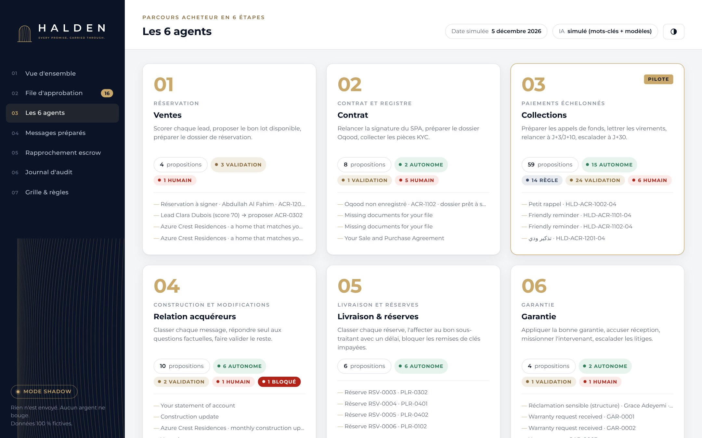
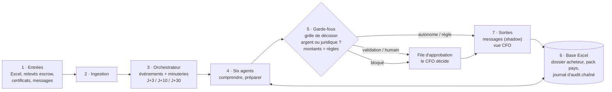
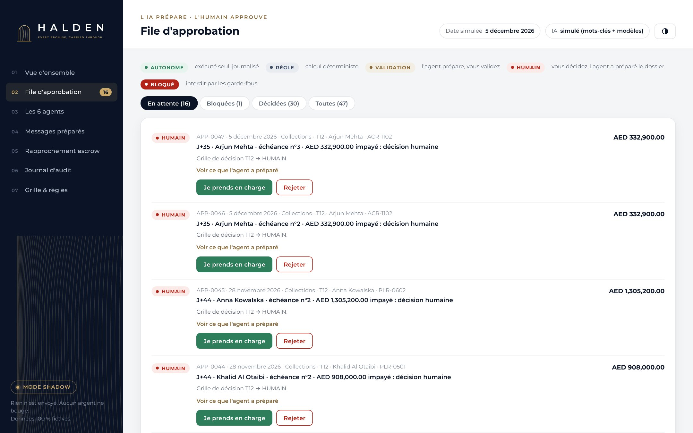

<p align="center">
  
</p>

<p align="center"><b>Le back office IA des promoteurs off-plan.</b><br>
L'IA prépare, les règles calculent, un humain engage le promoteur. Aucun argent ne bouge. Tout est journalisé.</p>

<p align="center">
  
  
  
  
</p>

---

Ce dépôt est la **preuve de concept** du moteur agentique Halden : six agents qui suivent un acheteur de la
réservation à la garantie, pour un promoteur fictif à Dubaï. Il tourne sur un ordinateur portable, lit et
réécrit une **base Excel** de données fictives réalistes, et s'affiche dans une **console web** aux couleurs
de Halden.


## Lancer la démo en 2 minutes

**Windows** : double-cliquez sur `lancer_demo.bat`. C'est tout.

**Mac, Linux ou Windows en ligne de commande** :

```bash
pip install -r requirements.txt
python -m halden demo        # rejoue 3 journées simulées dans le terminal
python -m halden console     # ouvre la console sur http://localhost:8765
```

La démo recrée `donnees/halden_base.xlsx`, fait tourner les agents sur trois dates, simule les décisions
du CFO, puis affiche la vue CFO et vérifie le journal d'audit. Ouvrez ensuite le fichier Excel : chaque
onglet a été mis à jour par les agents.

## Ce que montre la démo

| Date simulée | Ce qui arrive | Ce que font les agents |
|---|---|---|
| **2 nov. 2026** | Certificat d'avancement 40 % d'Azure Crest, 7 messages d'acquéreurs, 6 leads, 6 réserves, 4 réclamations | 20 appels de fonds préparés pour validation, relances J+3 et J+10 envoyées seules, FAQ répondues, demande de remboursement **bloquée** et passée à un humain, réserves affectées aux sous-traitants |
| **28 nov. 2026** | Le relevé du compte escrow est déposé (`donnees/entrees/`) | 14 virements sur 18 lettrés seuls (référence + montant), 3 rapprochements probables à valider, 1 virement inconnu, escalades J+30 |
| **5 déc. 2026** | Les minuteries tournent | Relances J+3 sur les appels non payés, escalades humaines, vue CFO du matin |

## Les six agents, dans l'ordre du parcours acheteur

| # | Agent | Étape | Ce qu'il fait seul | Ce qu'il fait valider |
|---|---|---|---|---|
| 01 | **Ventes** | Réservation | Score chaque lead, propose le bon lot | Relance du lead, dossier de réservation (signature humaine) |
| 02 | **Contrat** | Contrat et registre | Demande les pièces KYC manquantes | Relance de signature du SPA, dossier Oqood à soumettre à la DLD |
| 03 | **Collections** · *pilote* | Paiements échelonnés | Lettrage exact, relances J+3 et J+10 | Appels de fonds, rapprochements ambigus, escalade J+30 |
| 04 | **Relation acquéreurs** | Construction et modifications | Classe chaque message, répond aux questions factuelles (EN, AR, FR) | Modifications, actualité chantier, difficultés de paiement |
| 05 | **Livraison & réserves** | Livraison | Classe chaque réserve, l'affecte au sous-traitant avec un délai | Remise des clés bloquée tant qu'un solde est dû (règle) |
| 06 | **Garantie** | Garantie | Applique la bonne garantie, accuse réception | Refus hors garantie, litiges et désordres structurels |



## L'architecture en sept couches



Chaque couche est un fichier lisible du dossier `halden/` :

| Couche | Fichier | Rôle |
|---|---|---|
| 1-2 | `ingestion.py` | Lit les relevés escrow CSV déposés dans `donnees/entrees/` |
| 3 | `orchestrator.py` | Détecte les événements, réveille les agents, applique les garde-fous |
| 4 | `agents/*.py` | Les six agents. Ils rendent des **propositions**, jamais des actions |
| IA | `llm.py` | Comprendre et rédiger : mode simulé par défaut, Claude ou Bedrock en option |
| 5 | `rules.py`, `guardrails.py` | Montants, échéances, lettrage, garanties ; liste noire et contrôle des montants |
| 6 | `db.py`, `audit.py` | Base Excel et journal d'audit chaîné par hash |
| 7 | `approvals.py`, `execution.py`, `cfo.py`, `console.py` | File d'approbation, exécution, vue CFO, console web |

## Les garde-fous

1. **Liste noire.** Virement, remboursement, changement de prix, résiliation, report d'échéance : un agent ne
   peut pas les exécuter. Il peut seulement les signaler, et la demande part chez un humain.
2. **Grille de décision.** Chaque tâche a des notes de valeur (V1-V3) et de complexité (C1-C4) dans l'onglet
   `Grille_Decision`. L'arbre de décision en déduit son niveau : autonome, règle, validation ou humain.
   Changez une note dans Excel, et le comportement change au cycle suivant.
3. **Test « argent ou juridique ? »** Si la proposition engage le promoteur, elle n'est jamais autonome.
4. **Contrôle des montants.** Tout montant écrit par l'IA doit sortir du moteur de règles. Sinon le brouillon
   est rejeté (voir `tests/test_poc.py`).
5. **Mode shadow.** Rien n'est envoyé : tout est préparé, montré et journalisé. C'est le mode du pilote de 4 semaines.



## La base Excel

`donnees/halden_base.xlsx` contient 20 onglets aux couleurs de Halden. Les principaux :

| Onglet | Contenu |
|---|---|
| `Projets`, `Jalons`, `Unites` | 2 projets fictifs (Azure Crest Residences à JVC, Palm Lumen Residences à Dubai Hills), 36 lots |
| `Acheteurs`, `Contrats` | 32 acheteurs fictifs, SPA, statut Oqood, pièces KYC |
| `Echeancier` | Plan 60/40 : 10 % réservation, 10 % SPA, 4 × 10 % aux jalons, 40 % à la remise des clés |
| `Releve_Bancaire` | Virements reçus sur le compte escrow et leur lettrage |
| `Relances`, `Messages_Entrants`, `Messages_Sortants` | Ce qui entre, ce que les agents préparent |
| `Leads`, `Reserves`, `Garantie`, `Sous_Traitants` | Ventes, livraison, après-livraison |
| `Grille_Decision`, `Pack_Pays` | Qui décide quoi ; les règles de Dubaï (à faire valider par un avocat) |
| `File_Approbation`, `Journal_Audit` | Les décisions humaines et la trace complète |

`donnees/exemple_apres_demo.xlsx` montre la même base après les trois journées de la démo.

**Essayez :** ajoutez une ligne dans `Messages_Entrants` (statut `NOUVEAU`), puis lancez un cycle
(`python -m halden cycle` ou le bouton dans la console). L'agent Relation acquéreurs la traite.

## Brancher Claude

Par défaut, l'IA est **simulée** (mots-clés et modèles de texte) : gratuit, reproductible, rien ne sort de la
machine. Pour utiliser Claude :

```bash
pip install anthropic pydantic
export ANTHROPIC_API_KEY=...          # Windows : set ANTHROPIC_API_KEY=...
export HALDEN_LLM=claude              # ou bedrock (AWS me-central-1, cible du pilote)
python -m halden demo
```

Claude classe alors les messages et rédige les brouillons. Il reçoit les montants déjà calculés, et les
garde-fous rejettent tout brouillon qui en contient un autre. Si l'appel échoue, le moteur repasse en mode simulé
et le note dans le journal.

## Commandes

```bash
python -m halden demo [--interactif]   # scénario complet ; --interactif : vous validez vous-même
python -m halden console               # console web locale
python -m halden init                  # recrée la base fictive
python -m halden cycle --date 2026-11-02
python -m halden file                  # file d'approbation
python -m halden approuver APP-0001    # ou : rejeter APP-0001 --commentaire "..."
python -m halden cfo                   # vue CFO
python -m halden audit                 # vérifie le journal
python -m halden export                # console en une page HTML autonome
python -m unittest discover -s tests   # tests
```

## Limites du POC

- Les données sont **fictives** ; les noms de personnes, sociétés, IBAN et téléphones sont inventés.
- Les règles de Dubaï du `Pack_Pays` (délais, garanties, frais Oqood) sont marquées **À VÉRIFIER** par un avocat local.
- La grille de décision est une **hypothèse** d'équipe, à tester en entretiens avec des directions financières.
- Les intégrations réelles (Open Finance AlTareq, WhatsApp Business, API de la DLD) ne sont pas branchées :
  le POC lit des fichiers, comme le pilote.

<p align="center"><br>
<sub>HALDEN · Every promise, carried through. · Dubaï · 2026</sub></p>
