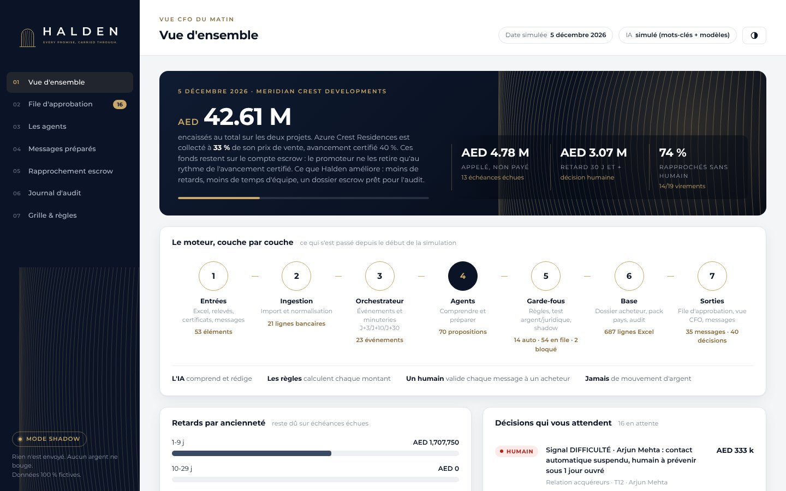
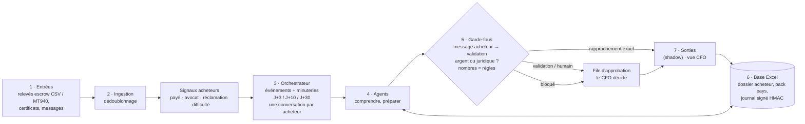

<p align="center">
  
</p>

<p align="center"><b>Le back office IA des promoteurs off-plan.</b><br>
L'IA prépare, les règles calculent, un humain valide chaque message à un acheteur. Aucun argent ne bouge. Tout est journalisé.</p>

<p align="center">
  
  
  
  
</p>

---

Ce dépôt est la **preuve de concept** du moteur agentique Halden pour un promoteur fictif à Dubaï. Le
**pilote** porte sur un seul agent, les **encaissements** (appels de fonds, rapprochement du compte escrow,
relances), avec sa boîte de réception acheteurs. Les quatre autres agents (ventes, contrat, livraison,
garantie) restent en **vision** et ne tournent qu'avec `--vision`. Le POC lit et réécrit une **base Excel**
de données fictives et s'affiche dans une **console web** aux couleurs de Halden.

> **Règle d'approbation du pilote** : chaque message vers un acheteur est préparé par l'agent et **validé
> par un humain**. Elle est écrite dans le code (`guardrails.py`), pas dans l'Excel : aucune note de la
> grille ne peut la lever. Seule exception sans humain : un rapprochement bancaire dont la référence, le
> payeur et le montant concordent exactement (aucun message ne part, l'échéance est constatée payée).



## Lancer la démo en 2 minutes

**Windows** : double-cliquez sur `lancer_demo.bat`. C'est tout.

**Mac, Linux ou Windows en ligne de commande** :

```bash
pip install -r requirements.txt
python -m halden demo            # pilote encaissements : 3 journées simulées dans le terminal
python -m halden demo --vision   # les six agents
python -m halden console         # ouvre la console sur http://localhost:8765
```

## Ce que montre la démo (pilote)

Tous les chiffres ci-dessous sont **ceux de notre démo, sur des données fictives**. Ils servent à montrer le
fonctionnement, pas à promettre un résultat. C'est le seul jeu de chiffres de démo utilisé dans nos documents.

| Date simulée | Ce qui arrive | Ce que fait le moteur |
|---|---|---|
| **2 nov. 2026** | Certificat d'avancement 40 % d'Azure Crest, 11 messages d'acheteurs | 20 appels de fonds et 4 relances préparés pour validation ; « j'ai payé » (en arabe), « avocat » et « j'ai perdu mon emploi » **suspendent tout contact automatique** et alertent un humain ; « l'assistant d'Omar » ne reçoit aucune donnée ; la demande de remboursement est **bloquée** |
| **28 nov. 2026** | Le relevé du compte escrow est déposé (`donnees/entrees/`) | **14 virements sur 19 rapprochés sans humain** (référence, payeur et montant exacts) ; 5 vont au CFO, dont un paiement fait avec **la référence d'un autre acheteur** (jamais affecté seul) ; un virement **rejeté** par la banque remet l'échéance en impayé ; escalades J+30 avec la **procédure de défaut DLD** |
| **5 déc. 2026** | Les minuteries tournent | Une seule relance par acheteur en retard (validée), aucune pour ceux dont un paiement attend ou qui ont signalé quelque chose ; vue CFO du matin |

## Ce qui a changé après la revue du 24 octobre 2026

Chaque point de la revue est couvert par un test dans `tests/test_revue.py`.

| Revue | Correction |
|---|---|
| Paiement attribué au mauvais acheteur (référence de Rashid, payé par Omar) | Un rapprochement exact n'est automatique que si **le nom du payeur correspond** ; sinon il part en file avec « la référence appartient à un autre acheteur » |
| Acheteur relancé alors qu'il a payé | **Aucune relance** tant qu'un paiement de cet acheteur est en validation, qu'un virement non identifié du même montant attend, ou qu'un dossier est escaladé |
| Messages contradictoires (relance aimable + escalade) | **Une seule conversation par acheteur et par cycle** : une relance regroupe toutes ses échéances ; dès qu'un point est escaladé, tout le reste attend |
| « J'ai payé », « avocat » ignorés | Signaux **payé, avocat, réclamation, difficulté** (anglais, français, arabe), détectés avant toute IA : contact automatique suspendu, humain alerté. Réactivation par un humain : `python -m halden reactiver ACH-007` |
| Contrôle des montants trop étroit | Chaque **nombre, pourcentage et date** est lu dans toute écriture (« 321,000 AED », « 321k », chiffres arabes, « درهم », USD, %) et doit venir des faits du moteur ; un **brouillon modifié par un humain** repasse le contrôle |
| Relevé : formats, frais, rejets, doublons | Références lues dans tous les formats (`HLDACR040203`, `ACR-0402-03`, « unit ACR-0402 instalment 3 ») ; écart de frais bancaires → validation ; débits lus, **virement rejeté → échéance redevenue due** ; plusieurs mises en page CSV et **MT940** ; doublons détectés sur le contenu |
| Pas de modèles arabes | Modèles arabes pour les relances, la FAQ, le KYC, la garantie et l'accusé de réception (**à faire relire par un locuteur natif**) |
| Qui écrit ? | L'expéditeur doit être le contact enregistré ; un tiers (« Omar's assistant ») reçoit une réponse neutre, sans aucune donnée |
| Journal d'audit recalculable ou tronquable | Chaîne **signée HMAC** avec une clé hors du classeur, et **ancre** de fin de chaîne hors du classeur |
| « 90 % » présenté comme une probabilité | Renommé **indice de tri** ; formule et seuils documentés dans `rules.py` |
| N'importe qui rend une tâche autonome dans Excel | **Plancher par tâche dans le code** ; la grille ne peut que durcir. Colonne `sensibilite` : quelles décisions basculent si une note bouge d'un point |
| Approbations sans connexion | Liste `approbateurs_autorises` ; une vraie connexion (SSO du promoteur) est un prérequis du pilote |
| Données envoyées hors des Émirats | En mode Claude, les faits partent **masqués** (⟦nom⟧, ⟦montant⟧…) et sont remis en place au retour |
| Coût de l'IA inconnu | Modèle par défaut **Claude Haiku 5.5** ; tokens comptés et chiffrés à chaque cycle (journal `CONSOMMATION_IA`) |
| Procédure de défaut de Dubaï absente | À J+30, l'escalade joint la **notification à la DLD** et l'option selon l'avancement certifié (pack pays, **à valider par un juriste émirati**) |
| Périmètre trop large | Pilote = encaissements seuls ; les autres agents en vision |
| Repli IA journalisé une fois par cycle | Chaque repli est journalisé avec sa cause |

## Banc d'essai

```bash
python tools/banc_essai.py
```

200 lignes de relevé piégées (référence d'un autre acheteur, frais, paiements partiels, noms inversés,
sociétés, références déjà soldées, formats compacts) et 100 messages. Résultat au 25 octobre 2026 :
**0 faux rapprochement automatique**, 37 % de lignes rapprochées sans humain, 0 signal manqué.
**Limite** : ce jeu est écrit par l'équipe, comme la démo. Le vrai taux se mesurera sur un relevé anonymisé
d'un promoteur, avant tout pilote.

## Les agents

| # | Agent | Statut | Ce qu'il fait sans humain | Ce qui passe par un humain |
|---|---|---|---|---|
| 03 | **Encaissements** | **pilote** | Rapprochement exact (référence + payeur + montant), calculs | Appels de fonds, relances, rapprochements ambigus, virements rejetés, escalade J+30 |
| 04 | **Relation acquéreurs** | pilote (boîte de réception) | Classer le message, détecter les signaux, vérifier l'expéditeur | Toute réponse à un acheteur |
| 01 | Ventes | vision | Score des leads | Relance du lead, réservation |
| 02 | Contrat | vision | | Relance SPA, KYC, dossier Oqood |
| 05 | Livraison & réserves | vision | Tri des réserves | Remise des clés bloquée tant qu'un solde est dû |
| 06 | Garantie | vision | Garantie applicable (règle) | Réponses, litiges |

## L'architecture en sept couches



| Couche | Fichier | Rôle |
|---|---|---|
| 1-2 | `ingestion.py` | Relevés escrow CSV (plusieurs banques) et MT940, crédits et débits, dédoublonnage |
| 3 | `orchestrator.py`, `signaux.py` | Événements, signaux acheteurs, suspensions, une conversation par acheteur |
| 4 | `agents/*.py` | Les agents rendent des **propositions**, jamais des actions |
| IA | `llm.py` | Mode simulé par défaut ; Claude ou Bedrock en option, données masquées, coût compté |
| 5 | `rules.py`, `guardrails.py` | Montants, rapprochement, procédure de défaut ; règle du pilote, planchers, contrôle des nombres |
| 6 | `db.py`, `audit.py` | Base Excel ; journal chaîné, signé et ancré |
| 7 | `approvals.py`, `execution.py`, `cfo.py`, `console.py` | File d'approbation, exécution, vue CFO, console web |

## Escrow : ce qui s'améliore vraiment

Les acheteurs paient sur le compte escrow du projet ; le promoteur n'en retire l'argent qu'au rythme de
l'avancement certifié. Encaisser plus vite ne lui donne donc pas le cash plus vite. Ce que le moteur
améliore pour le directeur financier : **moins de retards, moins de temps d'équipe, un dossier escrow
prêt pour l'audit**.

## Brancher Claude

```bash
pip install anthropic pydantic
export ANTHROPIC_API_KEY=...          # Windows : set ANTHROPIC_API_KEY=...
export HALDEN_LLM=claude              # ou bedrock (AWS me-central-1, cible du pilote)
export HALDEN_MODELE=claude-haiku-5-5 # par défaut ; comparer avec claude-sonnet-5-5
python -m halden demo
```

Claude classe les messages et rédige les brouillons à partir des modèles. Il ne voit que des marqueurs
(⟦nom⟧, ⟦montant⟧, ⟦ref⟧) ; les vraies valeurs sont remises après coup, puis les garde-fous contrôlent
chaque nombre. Chaque cycle journalise les tokens consommés et un coût estimé aux prix publics de l'API
(Haiku 5.5 : 0,10 $ / 0,50 $ par million de tokens en entrée / sortie). Bedrock a sa propre grille, à
vérifier. **Pas encore testé avec une vraie clé** : la mesure du coût par appartement et par mois est la
prochaine étape, à comparer à l'hypothèse du plan (AED 0,30 par appartement et par mois).

## Commandes

```bash
python -m halden demo [--interactif] [--vision]
python -m halden console               # console web locale
python -m halden init                  # recrée la base fictive
python -m halden cycle --date 2026-11-02
python -m halden file                  # file d'approbation
python -m halden approuver APP-0001    # ou : rejeter APP-0001 --commentaire "..."
python -m halden reactiver ACH-007     # réactive le contact automatique après décision humaine
python -m halden cfo                   # vue CFO
python -m halden audit                 # vérifie le journal
python -m halden export                # console en une page HTML autonome
python -m unittest discover -s tests   # 25 tests
python tools/banc_essai.py             # banc d'essai
```

## Limites du POC

- Les données sont **fictives** ; noms, sociétés, IBAN et téléphones sont inventés.
- Les règles de Dubaï du `Pack_Pays` (délais, garanties, procédure de défaut) sont **À VÉRIFIER** par un juriste émirati.
- La grille de décision est une **hypothèse** d'équipe, à noter avec un directeur financier en entretien.
- Les modèles arabes doivent être relus par un locuteur natif.
- Le PDF de relevé n'est pas lu (CSV et MT940 seulement).
- Les approbations n'ont pas de vraie connexion ; la clé d'audit est un fichier local (KMS en production).
- Les intégrations réelles (Open Finance AlTareq, WhatsApp Business, API de la DLD) ne sont pas branchées.

<p align="center"><br>
<sub>HALDEN · Every promise, carried through. · Dubaï · 2026</sub></p>
